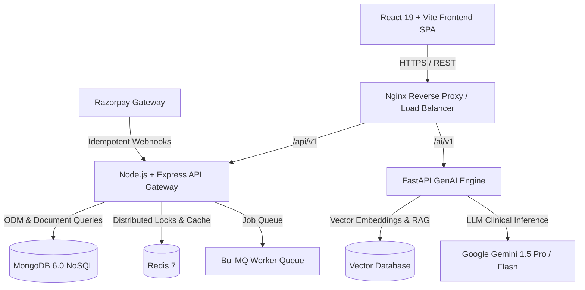

# EVE Health+ Architecture Documentation

## High-Level System Architecture

EVE Health+ is designed as an enterprise-grade multi-tenant healthcare diagnostic booking SaaS platform. It leverages a microservices-inspired monorepo design, combining real-time distributed locking, idempotent payment processing, role-based access control (RBAC), and a Retrieval-Augmented Generation (RAG) AI assistant.

## Architectural Highlights

### 1. Booking Engine & Slot Locking
- **Double Booking Prevention**: Uses Redis distributed locks (`SET key val EX 15 NX`) scoped by `centerId:testId:appointmentTime`.
- **Database Transactions**: PostgreSQL ACID isolation ensures that booking creation and payment initialization execute atomically.

### 2. Idempotent Webhook Processing
- Webhook endpoints accept payment capture/failure events.
- Events are hashed using SHA-256 (`payloadHash`) and verified against the `WebhookEvent` table.
- Concurrent duplicate events are blocked by short-lived Redis lock keys (`webhook_lock:eventId`).
- State Machine Protection prevents illegal transitions (e.g. `SUCCESS` -> `PENDING`).

### 3. Enterprise Authentication
- **Password Hashing**: Argon2id hashing algorithm for resistant credential storage.
- **Refresh Token Rotation**: Short-lived Access Tokens (15 mins) and rotatable Refresh Tokens (7 days) stored with revocation tracking.
- **Device Fingerprinting & Session Audit**: Tracks active user devices, IP addresses, and records security audit logs.
- **Account Locking**: Automatically locks accounts after 5 consecutive failed login attempts.

### 4. Healthcare AI Engine
- Built with **FastAPI**, **LangChain**, and **RAG Architecture**.
- **Symptom Analyzer**: Maps symptoms to clinical categories (Hematology, Endocrinology, Cardiology) and suggests specific tests.
- **RAG Knowledge Base**: Embeds medical preparation guidelines for fast, accurate retrieval.
