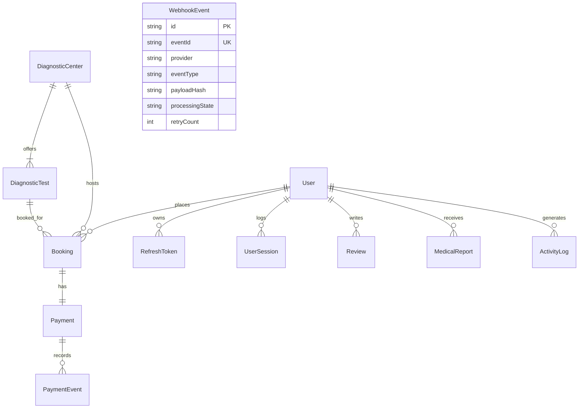

# EVE Health+ Database ER Diagram

## Entity Relationship Diagram (Mermaid)

## Table Definitions

### `Users`
- `id`: UUID (Primary Key)
- `email`: String (Unique)
- `passwordHash`: String (Argon2id)
- `firstName`, `lastName`: String
- `role`: Enum (`PATIENT`, `CENTER_ADMIN`, `PLATFORM_ADMIN`)
- `isLocked`: Boolean
- `failedLogins`: Int

### `DiagnosticCenters`
- `id`: UUID
- `name`: String
- `location`: String
- `contactEmail`, `contactPhone`: String

### `DiagnosticTests`
- `id`: UUID
- `centerId`: Foreign Key -> DiagnosticCenters.id
- `name`, `description`: String
- `category`: String
- `prepInstructions`: String
- `price`: Float
- `durationMin`: Int

### `Bookings`
- `id`: UUID
- `userId`: Foreign Key -> Users.id
- `testId`: Foreign Key -> DiagnosticTests.id
- `centerId`: Foreign Key -> DiagnosticCenters.id
- `appointmentDate`: DateTime
- `amount`: Float
- `status`: Enum (`PENDING`, `CONFIRMED`, `FAILED`, `CANCELLED`, `RESCHEDULED`, `COMPLETED`)

### `Payments`
- `id`: UUID
- `bookingId`: Foreign Key -> Bookings.id (Unique)
- `amount`: Float
- `currency`: String
- `gatewayOrderId`: String
- `gatewayPaymentId`: String
- `status`: Enum (`PENDING`, `PROCESSING`, `SUCCESS`, `FAILED`, `REFUNDED`)
